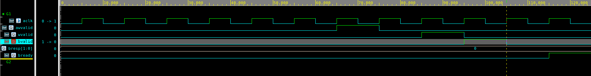
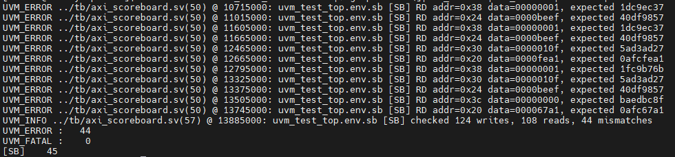
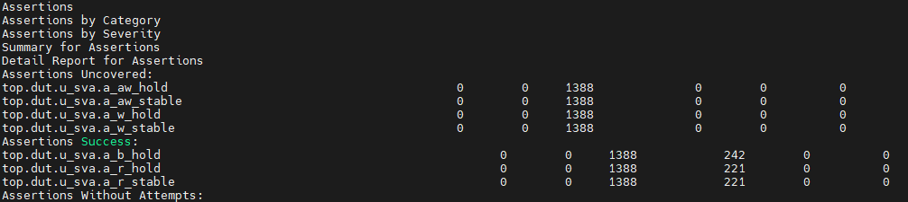
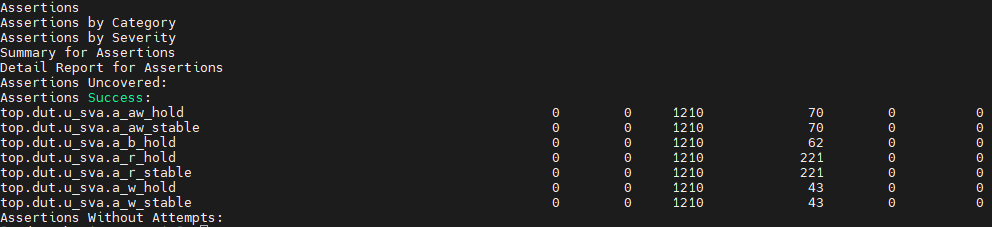
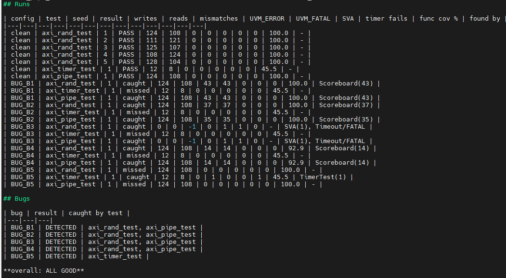
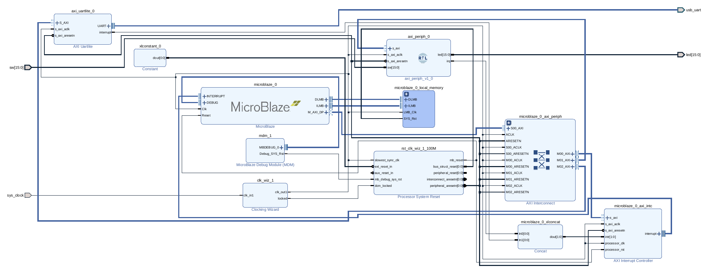

# AXI4-Lite Peripheral UVM 검증 & MicroBlaze SoC 통합

LED · 스위치 · 타이머 · 인터럽트를 가진 AXI4-Lite 슬레이브 페리퍼럴을 **UVM으로 검증**하고,
검증한 RTL을 **MicroBlaze SoC에 통합해 Basys3 보드에서 동작 확인**한 프로젝트.

| 항목 | 결과 |
|---|---|
| 주입 버그 검출 | **5 / 5** (프로토콜 · 데이터 · W1C) |
| 기능 커버리지 | **100%** (covergroup) |
| ASSERT 커버리지 | **45.45% → 81.82%** (검사 안 되던 assertion 발견 후 보완) |
| 스코어보드 오판 | **mismatch 44 → 0** (RAL 예상 모델 도입) |
| 회귀 | 설정 6 × 테스트 3 (clean은 seed 5개) = **22회 자동 실행 · ALL GOOD** |
| 보드 | Basys3 (Artix-7), MicroBlaze + AXI INTC, 폴링 · 인터럽트 C 드라이버 |

- Tools: Synopsys VCS · Verdi · URG, Vivado / Vitis 2020.2, Python
- 역할: 검증 환경 · 테스트 시나리오 · 디버깅 · SoC 통합은 직접 수행, RTL은 AI 도움을 받아 작성
- 발표 자료 (PDF): `docs/` · 보드 영상: [링크]

---

## 1. DUT 레지스터 맵

| 주소 | 이름 | 접근 | 설명 |
|---|---|---|---|
| 0x00–0x1C | SCRATCH0–7 | RW | 범용 레지스터 |
| 0x20 | LED_OUT | RW | led[15:0] 출력 |
| 0x24 | SW_IN | RO | sw[15:0] 입력 |
| 0x28 | TMR_CTRL | RW | [0] EN, [1] AUTO_RELOAD |
| 0x2C | TMR_LOAD | RW | 타이머 비교값 |
| 0x30 | TMR_COUNT | RO | 카운터 |
| 0x34 | TMR_STATUS | W1C | [0] DONE |
| 0x38 | IRQ_EN | RW | 인터럽트 허용 |
| 0x3C | RESERVED | RAZ/WI | |
| 0x40~ | – | – | SLVERR |

`irq = DONE & IRQ_EN` · 자세한 스펙: `docs/peripheral_spec.md`

## 2. 검증 환경

```
test (axi_rand_test · axi_timer_test · axi_pipe_test)
 └─ env
     ├─ agent : sequencer · driver (axi_pipe_driver로 교체 가능) · monitor
     ├─ scoreboard : RAL(uvm_reg) 예상 모델
     └─ coverage : covergroup
 DUT + SVA 8개 (bind) : AW/W/B/R 채널 VALID 유지 · 데이터 고정 · BRESP 값
```

| 확인 대상 | 검사기 |
|---|---|
| AXI 핸드셰이크 규칙 | SVA 8개 |
| 레지스터 값 | RAL 스코어보드 |
| 타이머 · W1C · 인터럽트 | directed test (RAL frontdoor, 13 checks) |
| 접근 다양성 | 제약 random + 기능 커버리지 |
| 실제로 검사됐는지 | URG (assertion · code coverage) |
| 버그 검출 능력 | 버그 5종 주입 + regress.py |

## 3. 버그 주입 결과

| 버그 | 내용 | 검출 |
|---|---|---|
| B1 | WSTRB 무시 | 스코어보드 |
| B2 | W가 AW보다 먼저 오면 데이터 손실 | 스코어보드 |
| B3 | BREADY 없이 BVALID 하강 | SVA a_b_hold + Timeout |
| B4 | 잘못된 주소에 OKAY 응답 | 스코어보드 |
| B5 | W1C가 데이터 비트 무시 | timer test만 검출 (random은 놓침) |



## 4. 트러블슈팅

### 4-1. 스코어보드 mismatch 44건 (RAL 도입)
- **현상**: clean RTL인데 mismatch 44건
- **원인**: "쓴 값 = 읽은 값" 메모리형 모델 → RO · W1C · RAZ/WI · 하드웨어 변경 값 예측 불가
- **해결**: uvm_reg로 필드별 접근 규칙 정의, volatile 필드(SW · COUNT · DONE)는 비교 제외 후 directed test로 검증
- **결과**: 같은 RTL · seed에서 mismatch 44 → 0



### 4-2. 에러 0인데 assertion 4개가 실제로 검사 안 됨
- **현상**: URG ASSERT 45.45%, AW/W hold · stable 4개 Real Successes 0 (vacuous pass)
- **원인**: DUT는 항상 READY=1, driver는 한 번에 1개 전송 → VALID=1 · READY=0 대기 상황 미발생
- **해결**: AW · W · B 채널을 스레드로 분리한 `axi_pipe_driver` (write 최대 4개 동시 전송), factory override로 driver만 교체
- **결과**: AW 0 → 70회, W 0 → 43회 실제 검사 (테스트가 센 대기 횟수와 일치), ASSERT 45.45 → 81.82%

| Before | After |
|---|---|
|  |  |

## 5. 회귀 테스트

`sim/regress.py` : 설정 6개(clean, BUG_B1–B5) × 테스트 3개 컴파일 · 실행 → 로그 수치로 PASS · caught · missed 판정 → 마크다운 표 저장



## 6. SoC 통합 (Basys3)

MicroBlaze → AXI Interconnect → `axi_periph_0` (`board/axi_periph.v`, 0x44A0_0000), irq → xlconcat → AXI INTC, UART Lite 115200



- `board/main.c` : 폴링 드라이버
- `board/main_irq.c` : 인터럽트 드라이버 (ISR에서 TMR_STATUS에 1을 써서 DONE 클리어, SW14로 IRQ_EN 마스크)

## 7. 실행 방법

```bash
cd sim
make uvm TEST=axi_rand_test SEED=1     # random
make uvm TEST=axi_timer_test           # 타이머 directed
make uvm TEST=axi_pipe_test            # 파이프라인 driver
make uvm TEST=axi_rand_test BUG=BUG_B3 # 버그 주입
python3 regress.py                     # 전체 회귀
```

## 8. 폴더 구조

```
rtl/    DUT (버그 B1~B5 ifdef)
tb/     UVM env, agent, RAL, SVA, coverage, tests/
sim/    Makefile, filelist, regress.py
board/  보드용 RTL, xdc, C 드라이버
docs/   스펙, 검증 계획, 발표 자료
images/ README 이미지
```

## 9. 한계와 다음 단계
- read 채널도 동시 전송하도록 driver 확장
- AXI GPIO (PG144) · AXI Timer (PG079) 실제 스펙 기준 재검증
- 테스트별 커버리지 merge, 타이머 경계값 시나리오 추가
